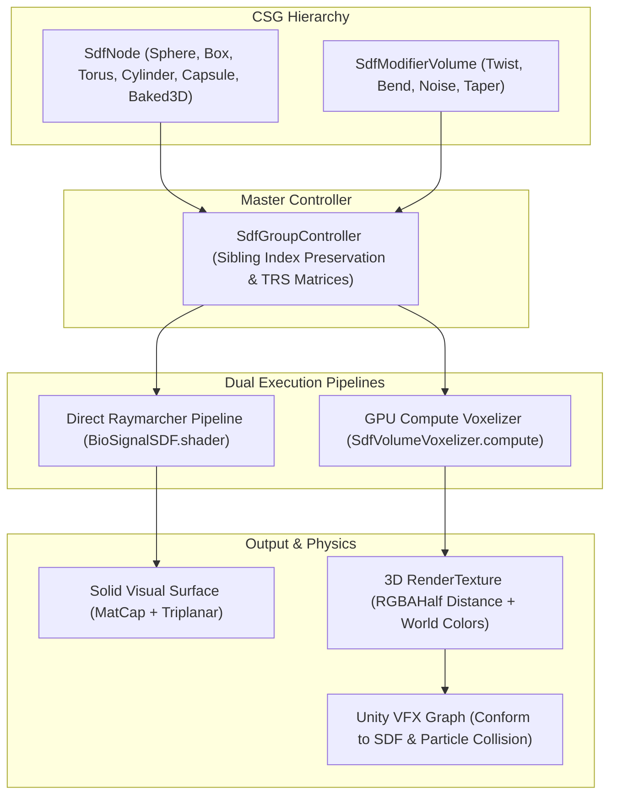

# About VolumetricSDF

Welcome to the **VolumetricSDF** technical documentation.

**VolumetricSDF** is a high-performance procedural implicit modeling, raymarching, and physics engine designed for **Unity 6 (Universal Render Pipeline)**. It enables real-time Constructive Solid Geometry (CSG), localized bounded force-field deformers, Morten Mikkelsen triplanar texturing, and a real-time **GPU Compute Voxelizer** ($16^3$ to $192^3$) with **Decoupled Chromatic Evaluation** for particle swarm interaction in **Unity VFX Graph**.

Originally developed as part of a Master's Thesis in Cinema and Media Engineering at **Politecnico di Torino**, the engine is tailored for **Mobile XR (Meta Quest 3 Standalone)** through an innovative **Fill-Rate Decoupling** architecture that slashes GPU frame time by **61.3%**.

  
  
   
  <em>Left: <b>Decoupled Chromatic Evaluation</b> on 128³ voxel grid. Right: <b>Bouba-Kiki Morphological Continuum</b>.</em>

---

## Core Architectural Pillars

### 1. Constructive Solid Geometry (CSG) & Hierarchy Preservation
* **Order-Independent CSG Evaluation**: Smooth Union, Smooth Subtraction, and Smooth Intersection evaluated sequentially according to the top-to-bottom order in the Unity Hierarchy (Sibling Index).
* **Polynomial Smooth Blending**: Continuous, $C^1$-smooth blending factor ($k$) preventing geometric pinching and topological artifacts.
* **Analytical Primitives & 3D Baked Volumes**: Spheres, Boxes, Tori, Cylinders, Capsules, plus $128^3$ pre-baked signed distance textures for complex scanned or procedural organic meshes.

### 2. Bounded Modifier Volumes (Force-Fields)
* **Localized Spatial Deformers**: Twist, Bend, and 3D Simplex/Perlin Noise applied exclusively within defined local bounding zones.
* **Hermite Falloff Transitions**: Smooth cubic attenuation ($3x^2 - 2x^3$) between the undisturbed global space and the fully deformed inner core.

### 3. GPU Voxelizer & Fill-Rate Decoupling
* **$128^3$ GPU Compute Voxelization**: Evaluates the multi-node CSG hierarchy and modifiers in a compute shader pass under $0.8\text{ ms}$, baking a 3D `RenderTexture` (format `RGBAHalf`).
* **Fill-Rate Decoupling**: Solves the mobile XR fill-rate bottleneck by disabling fragment-level screen raymarching and delegating collision physics and visual rendering to GPU particle swarms in VFX Graph.

### 4. Decoupled Chromatic Evaluation
* **Multi-Object Color Adhesion**: Distinct CSG nodes retain their own color identities across independent 3D coordinate spaces. Particles sampling the 3D texture inherit both distance for collision and chromatic attributes for dynamic tissue or material tinting.

### 5. Bouba-Kiki Cross-Modal Continuum
* **Morphological Biofeedback**: Algorithmic transition between rounded, low-frequency organic curvature (Bouba) representing relaxation, and high-frequency, angular tapering spikes (Kiki) representing acute stress.

---

## 🤝 Companion Package: PulseEngine

VolumetricSDF is designed as a standalone procedural geometry and voxelizer engine. To drive its parameters dynamically using real-time biometric sensors (ECG, SpO2, HRV via OSC/UDP/WebSockets) and a virtual hardware mixing desk, pair it with:

👉 **[PulseEngine](https://github.com/federicocolombo12/PulseEngine)** (`com.federicocolombo.pulseengine`)
