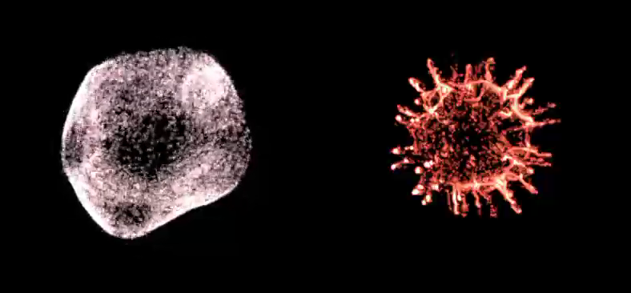

# Bouba-Kiki Morphological Continuum

The **Bouba-Kiki Morphological Continuum** translates human psycho-physiological states into continuous, intuitive 3D procedural geometries.

---

## 1. Theoretical & Neurological Background

Discovered by Wolfgang Köhler (1929) and expanded by Ramachandran & Hubbard (2001), the **Bouba-Kiki Effect** reveals that human cross-modal perception maps abstract shapes to phonemic, affective, and visceral concepts:

| Archetype | Perceptual Character | Somatic State | Geometric Characteristics |
| :--- | :--- | :--- | :--- |
| **Bouba** | Soft, rounded, continuous | Parasympathetic relaxation (low arousal) | Positive mean curvature ($H > 0$), low spatial frequency, smooth blending ($k > 0.15$). |
| **Kiki** | Sharp, angular, jagged | Sympathetic stress / arousal (high arousal) | Negative Gaussian curvature ($K < 0$), high spatial frequency, sharp cuts ($k \approx 0$), acute spikes. |

  
   
  <em>Left: <b>Bouba Archetype</b> (organic, parasympathetic). Right: <b>Kiki Archetype</b> (angular, sympathetic arousal).</em>

---

## 2. Mathematical Formalization

The continuous transition between Bouba and Kiki is governed by a state interpolation parameter $\alpha \in [0, 1]$:

$$\mathcal{S}(\mathbf{p}, \alpha) = (1 - \alpha) \cdot d_{\text{Bouba}}(\mathbf{p}) + \alpha \cdot d_{\text{Kiki}}(\mathbf{p}) + \mathcal{N}(\mathbf{p}, \alpha)$$

Where:
* $d_{\text{Bouba}}(\mathbf{p})$: Analytical union of spheres with smooth blending softness $k_{\text{eff}} = 0.25 \cdot (1 - \alpha)$.
* $d_{\text{Kiki}}(\mathbf{p})$: Directional conical and pyramidal primitives with sharp intersection and high taper.
* $\mathcal{N}(\mathbf{p}, \alpha)$: Localized 3D Perlin noise whose amplitude and frequency scale linearly with arousal:
  $$\text{NoiseAmp} = \alpha \cdot A_{\text{max}}, \quad \text{NoiseFreq} = f_0 + \alpha \cdot \Delta f$$

  
   
  <em>Real-time continuous morphological transition between Bouba and Kiki states.</em>

---

## 3. The `BoubaKikiTexture3DGenerator` Tool

To support offline baking of hyper-dense $128^3$ volumetric assets, VolumetricSDF includes a dedicated Editor Window:

1. In the Unity Editor, open **MedicalXR** > **Tools** > **Bouba-Kiki 3D Texture Generator**.
2. Configure grid resolution: `32^3`, `64^3`, or `128^3`.
3. Adjust morphological parameters:
   * **Bouba Soft Blending ($k$)**: Controls organic droplet melting.
   * **Kiki Spike Base Radius**: Controls spike thickness.
   * **Kiki Spike Length**: Controls spike protrusion.
4. Click **Bake Bouba (Texture3D)** or **Bake Kiki (Texture3D)**: the generator writes an optimized `.asset` containing an `RHalf` Texture3D directly into your project!
