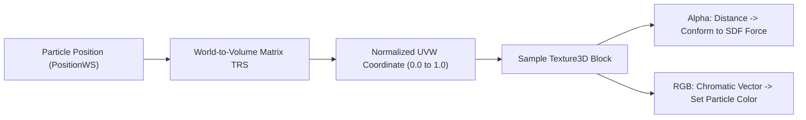

# Decoupled Chromatic Evaluation

A fundamental innovation in **VolumetricSDF** is the decoupling of spatial distance evaluation from localized chromatic attribution.

---

## 1. The Limitation of Standard Signed Distance Volumes

In traditional volumetric pipelines (e.g., standard MudBun, Unreal Engine distance fields, or classic raymarchers), a 3D texture only records a single scalar distance value:
$$\mathbf{V}(x, y, z) = d(x, y, z)$$
Consequently, when a particle system (such as Unity VFX Graph) interacts with the volume:
1. Particles can calculate adhesion or normal vectors: $\mathbf{n} = \nabla d$.
2. Particles **cannot** determine *which* object or semantic region of the geometry they are interacting with.
3. Coloring must either be applied globally or via separate spatial approximations, eliminating localized color identities in complex CSG assemblies.

---

## 2. The 4-Channel RGBAHalf Voxel Architecture

`SdfVolumeVoxelizer.compute` evaluates both the minimum distance field and the localized color contribution in a single GPU pass:

| Texture Channel | Data Encoded | Precision | Role in VFX Graph |
| :---: | :---: | :---: | :--- |
| **R** | Color Red ($0.0 - 1.0$) | 16-bit float | World-Space Particle Albedo Tint |
| **G** | Color Green ($0.0 - 1.0$) | 16-bit float | World-Space Particle Albedo Tint |
| **B** | Color Blue ($0.0 - 1.0$) | 16-bit float | World-Space Particle Albedo Tint |
| **A** | Signed Distance $d$ (meters) | 16-bit float | Surface Collision & Particle Adhesion Force |

```hlsl
// SdfVolumeVoxelizer.compute excerpt
float4 finalEvaluation = float4(accumulatedColor.rgb, finalDistance);
Result[id] = finalEvaluation;
```

---

## 3. World-Space Coordinate Sampling in VFX Graph

In **Unity VFX Graph**, particles query the volume texture using their world position converted into normalized UVW texture coordinates:



<p align="center">
  
  <br>
  <em>Live demonstration: the infinity loop CSG element retains vivid magenta coloration while the intersecting sphere retains cyan, with smooth chromatic blending at the CSG union intersection.</em>
</p>

---

## 4. Multi-Object Blending & Smooth Color Transitions

When two CSG nodes with different colors $C_1$ and $C_2$ undergo smooth polynomial blending ($k > 0$), the chromatic contribution is blended using the polynomial weight factor:

$$h = \text{clamp}\left(0.5 + 0.5 \cdot \frac{d_2 - d_1}{k}, 0.0, 1.0\right)$$
$$C_{\text{blended}} = \text{lerp}(C_2, C_1, h)$$

This ensures that the transition between adjacent organ tissues or procedural shapes does not suffer from harsh color seams or rasterization artifacts.
