# VolumetricSDF 🔮🧊

> **High-Performance Procedural CSG Raymarching, Bounded Modifier Volumes & Real-Time GPU Voxelizer for Unity 6**  
> Procedural implicit modeling, MudBun-style localized force fields, Morten Mikkelsen triplanar texturing, and $128^3$ GPU compute voxelization with decoupled chromatic evaluation for Unity VFX Graph and Mobile XR (Meta Quest 3).

[](https://unity.com/)
[](https://unity.com/srp/universal-render-pipeline)
[](https://unity.com/visual-effect-graph)
[](https://www.meta.com/quest/quest-3/)
[](#-meta-quest-3-standalone-benchmarks)
[](https://federicocolombo12.github.io/VolumetricSDF/)
[](LICENSE.md)

---

## 🌟 Overview

> 📖 **Full Technical Documentation & Architecture Manual**:  
> Explore guides, benchmarks, and interactive diagrams at **[federicocolombo12.github.io/VolumetricSDF](https://federicocolombo12.github.io/VolumetricSDF/)**

> [!TIP]
> **Modular Companion Architecture**: `VolumetricSDF` is a self-contained procedural implicit geometry and physics engine. For real-time multi-protocol telemetry routing (OSC, WebSockets, Serial, Simulators) and a virtual hardware mixing desk, pair it with **[PulseEngine](https://github.com/federicocolombo12/PulseEngine)** (`com.federicocolombo.pulseengine`).

**VolumetricSDF** bridges procedural mathematical geometry with real-time GPU particle physics. 

Unlike traditional mesh pipelines constrained by triangle counts, vertex buffers, and UV unwrapping, VolumetricSDF evaluates **continuous Signed Distance Fields (SDFs)** directly on the GPU. It combines:
1. **Order-Independent CSG Raymarching**: Spheres, Boxes, Tori, Cylinders, Capsules, and baked 3D volumes evaluated sequentially according to the Unity Hierarchy (Sibling Index) with $C^1$-continuous polynomial smooth blending.
2. **MudBun-Style Bounded Modifier Volumes**: Localized spatial force fields (Twist, Bend, Taper, 3D Simplex Noise) that warp coordinates exclusively within defined bounding boxes with smooth Hermite falloff.
3. **GPU Voxelizer & Fill-Rate Decoupling**: An asynchronous compute shader ($16^3$ to $192^3$) baking dynamic 3D textures (`RGBAHalf`) in $<0.8\text{ ms}$, dropping GPU frame times on **Meta Quest 3** from $42.4\text{ ms}$ to $11.2\text{ ms}$ (**locked 72/90 FPS**).
4. **Decoupled Chromatic Evaluation**: Evaluates both Euclidean distance ($d$, Alpha) and shape color ($C$, RGB) in a single hardware texture fetch, enabling over **250,000 VFX Graph particles** to cling, slide, and inherit per-node biological or material coloration.

---

## 🎬 Showcase

<p align="center">
  <a href="https://github.com/federicocolombo12/VolumetricSDF/raw/main/Documentation~/images/demo_raw.mp4">
    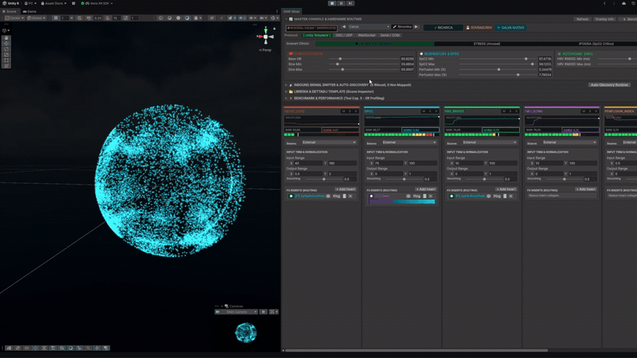
  </a>
  <br>
  <b>🎬 <a href="https://github.com/federicocolombo12/VolumetricSDF/raw/main/Documentation~/images/demo_raw.mp4">Watch Full 1080p In-Engine Walkthrough Video (75s)</a></b>
  <br>
  <em>Live demonstration: Real-time procedural CSG morphing, dynamic parameter modulation, MudBun modifier volumes, and GPU particle swarm voxelization.</em>
</p>

### Real-Time In-Engine Demonstrations

| Decoupled Chromatic Evaluation (VFX Graph) | Bouba-Kiki Morphological Continuum |
| :---: | :---: |
| 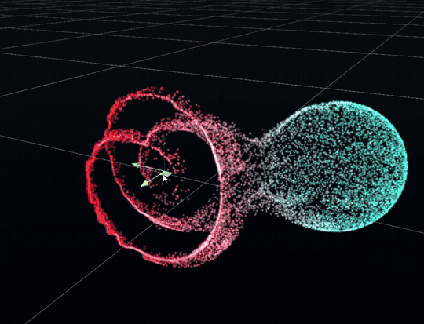 | 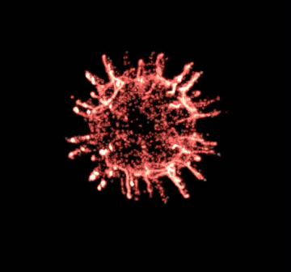 |
| *World-space decoupled color evaluation on $128^3$ voxel grid.* | *Continuous transition between calm (Bouba) and acute stress (Kiki).* |

| Procedural CSG Modeling & Hierarchy | VFX Particle Adhesion & Collision |
| :---: | :---: |
| 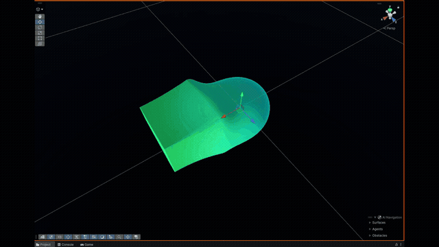 | 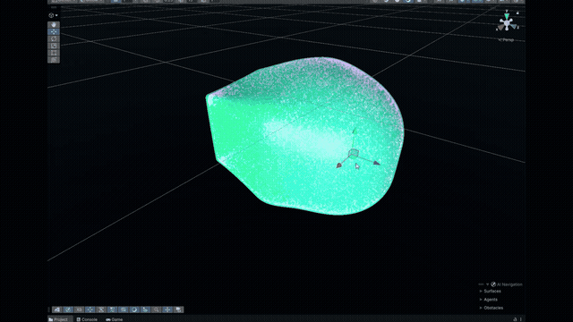 |
| *Real-time smooth union, subtraction, and modifier volumes.* | *Particles conforming tightly to implicit SDF distance zero-isosurface.* |

---

## 🏛️ High-Level System Architecture

VolumetricSDF executes across a streamlined, four-stage GPU compute and rendering pipeline:

<p align="center">
  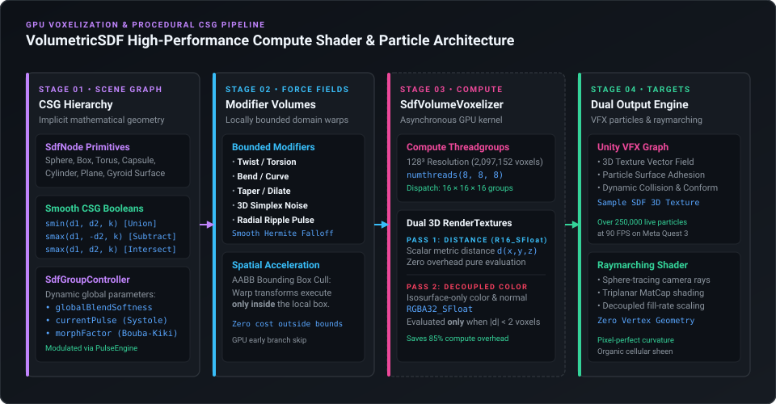
</p>

---

## ⚡ Key Architectural Features

### 🥽 1. Fill-Rate Decoupling Architecture (Mobile XR Optimization)
Standard sphere tracing raymarching evaluates distance equations per fragment ($O(\text{Width} \times \text{Height})$). At Meta Quest 3 native stereo render targets ($2064 \times 2208$ per eye), fullscreen raymarching induces severe GPU fill-rate throttling (~$42.4\text{ ms}$ frame time).

**VolumetricSDF** solves this bottleneck via **Fill-Rate Decoupling**:
* The procedural distance field is evaluated offscreen on the compute pipeline (`SdfVolumeVoxelizer.compute`) into an isotropic 3D `RenderTexture` (format `RGBAHalf`).
* Visual rendering and surface collision physics are delegated to **Unity VFX Graph** (`Conform to SDF`), which samples the 3D texture using lightweight billboard particles.
* The solid fragment raymarch mesh can be disabled entirely (`renderSolidMesh = false`) while retaining 100% geometric collision fidelity, dropping GPU frame time from **42.4 ms to 11.2 ms (locked 72/90 FPS on Meta Quest 3)**.

---

### 🎨 2. Decoupled Chromatic Evaluation
Traditional SDF systems bake only a scalar distance field $d(x,y,z)$. When particles or shaders query the volume, all visual identity and coloring must be applied uniformly.

VolumetricSDF introduces **Decoupled Chromatic Evaluation**:

<p align="center">
  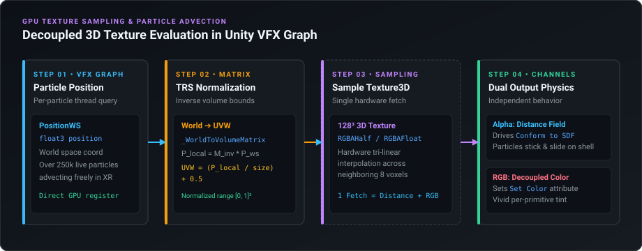
</p>

* **Single Hardware Texture Fetch**: Evaluates both metric distance (Alpha channel) and localized shape color (RGB channels) in one fetch.
* **Per-Particle Coordinate Projection**: Particles sample their true world coordinates against the volume matrix ($P_{\text{local}} = M^{-1} \cdot P_{\text{ws}}$), ensuring distinct CSG primitives retain their individual albedo or biological tints (e.g., vascular scarlet vs parenchymal cyan).
* **Smooth Color Morphing**: In CSG blend zones, polynomial smooth-min weighting smoothly interpolates between node colors, eliminating abrupt chromatic seams.

---

### 🧬 3. Procedural CSG Hierarchy & Sibling Cascade
VolumetricSDF renders solid procedural geometry using mathematical **Constructive Solid Geometry (CSG)** evaluated top-to-bottom according to the Unity Hierarchy's **Sibling Index**:

* **Analytic Primitives**: Sphere, Box, Torus, Cylinder, Capsule, and Baked 3D Textures (`.asset`).
* **CSG Operations**: `Union`, `Subtraction`, `Intersection`, `SmoothUnion`, `SmoothSubtraction`, `SmoothIntersection`.
* **$C^1$-Continuous Polynomial Smooth Blending (Inigo Quilez Formulation)**:
  $$h = \text{clamp}\left(0.5 + 0.5 \cdot \frac{d_2 - d_1}{k}, 0.0, 1.0\right)$$
  $$\text{SmoothUnion}(d_1, d_2, k) = \text{lerp}(d_2, d_1, h) - k \cdot h \cdot (1.0 - h)$$
  where $k$ is the per-node `blendSoftness` parameter.
* **Order-Independent Evaluation**: Re-ordering GameObjects in Unity's hierarchy window immediately updates the Boolean evaluation order without recompilation.

---

### 🌀 4. Bounded Modifier Volumes (MudBun-Style Force Fields)
Rather than applying global space distortions that tear whole scenes apart, VolumetricSDF adopts a **Standalone Modifier Volume** architecture:

<p align="center">
  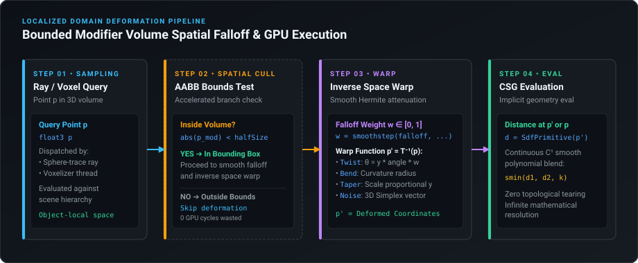
</p>

<p align="center">
  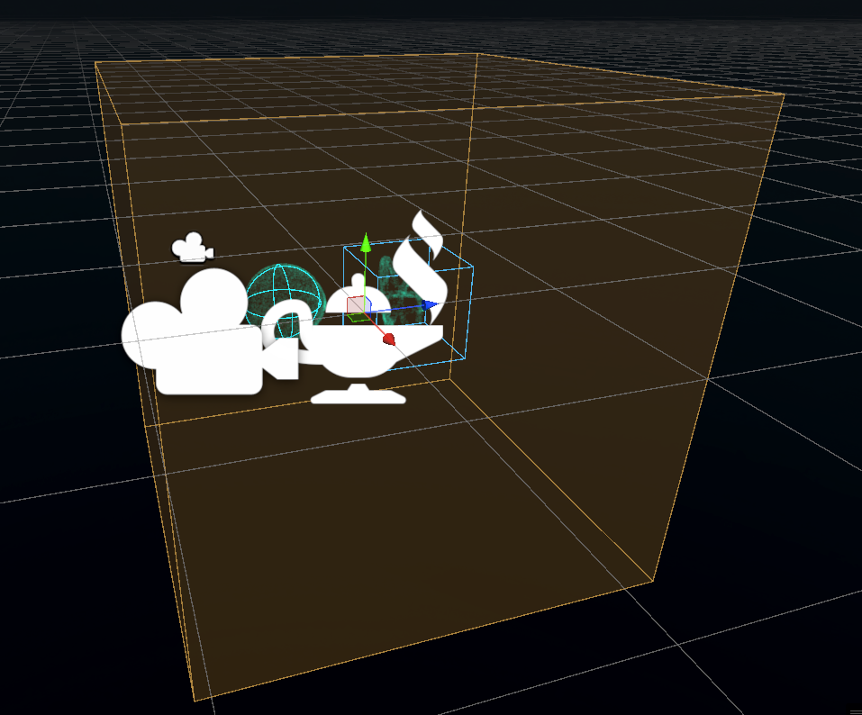
  <br><em>Scene view gizmo displaying double-wireframe bounds: inner core box (100% warp) and outer falloff margin (smooth attenuation).</em>
</p>

* **AABB Spatial Culling**: Coordinates outside the modifier's oriented bounding box skip deformation entirely with zero GPU cycle overhead.
* **Hermite Falloff Attenuation**: Coordinates within the falloff margin are warped via smooth cubic attenuation:
  $$w = \text{smoothstep}(1.0, 0.0, d_{\text{margin}})$$
* **Supported Warps**: Localized **Twist** (torsional contortion along local axis), **Bend** (polynomial curvature), **Taper** (axial scale dilation), and **3D Simplex Noise** (organic membrane displacement).

---

### 🧠 5. Bouba-Kiki Morphological Continuum
Grounded in cross-modal cognitive psychology (Wolfgang Köhler 1929, Ramachandran & Hubbard 2001) and Polyvagal Theory, VolumetricSDF translates human psycho-physiological arousal into continuous 3D morphology:

<p align="center">
  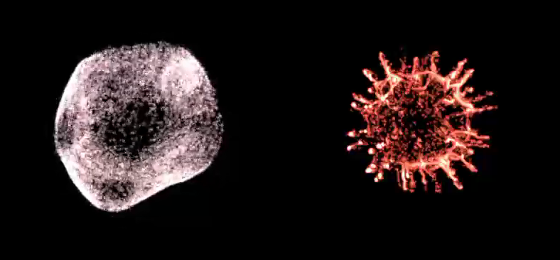
  <br>
  <em>Left: <b>Bouba State</b> (parasympathetic relaxation, positive mean curvature). Right: <b>Kiki State</b> (sympathetic arousal, negative Gaussian curvature and acute spikes).</em>
</p>

| Dimension / Parameter | 🟢 Bouba State (Parasympathetic / Relaxation) | 🔴 Kiki State (Sympathetic / Stress) |
| :--- | :---: | :---: |
| **Cognitive Affect** | Soft, comforting, grounded, restorative | Alerting, urgent, high-tension, energetic |
| **Geometric Curvature** | Positive mean curvature ($H > 0$), low spatial frequency | Negative Gaussian curvature ($K < 0$), acute tapering spires |
| **Blend Softness ($k$)** | $0.40\text{--}0.65\text{ m}$ (Melting / Organic) | $0.05\text{--}0.12\text{ m}$ (Rigid / Spiky) |
| **Particle Dynamics** | Gentle laminar flow, rhythmic breathing pulse | Chaotic divergence, high-frequency turbulence curl |

* Includes custom editor baking tool (**`BoubaKikiTexture3DGenerator`**) accessible via **MedicalXR > Tools > Bouba-Kiki 3D Texture Generator** to bake $32^3$ to $128^3$ volumetric assets (`.asset`) directly into the project.

---

### 🔬 6. Morten Mikkelsen Triplanar Texturing & MatCaps
Because Signed Distance Fields are defined mathematically in continuous 3D space, they possess no UV coordinates. VolumetricSDF incorporates an advanced implicit texturing pipeline:

<p align="center">
  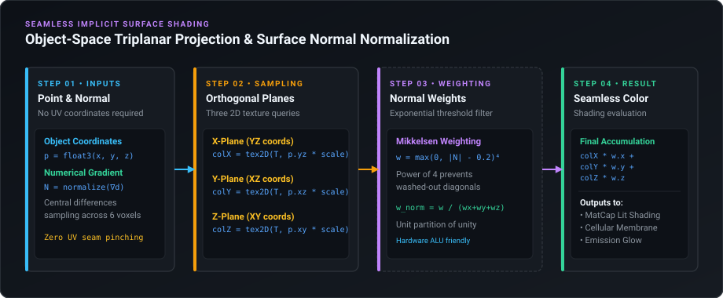
</p>

<p align="center">
  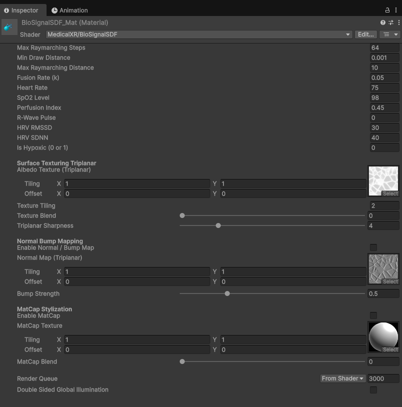
  <br><em>BioSignalSDF material inspector displaying raymarching steps, triplanar albedo tiling, Mikkelsen bump strength, and view-space MatCap blending.</em>
</p>

* **Morten Mikkelsen Surface Gradients**: Replaces sign-based triplanar bump mapping with Mikkelsen's formulation ($\nabla_{\text{surf}} h = \nabla h - (\mathbf{N} \cdot \nabla h)\mathbf{N}$). Eliminates $180^\circ$ normal flips and glaring seams across coordinate symmetry planes ($X=0, Y=0, Z=0$).
* **View-Space MatCaps**: Samples medical-grade spherical reference textures (`Medical_Bone_MatCap.png`, `Medical_Flesh_MatCap.png`) for organic cellular and clinical bone shading.
* **URP Dynamic Lighting**: Direct integration with `GetMainLight()` supporting Blinn-Phong specular highlights and Half-Lambert diffuse shading.

---

## 📊 Meta Quest 3 Standalone Benchmarks

Testing was conducted on **Meta Quest 3 Standalone** (Snapdragon XR2 Gen 2, Vulkan Graphics API, URP FFR Level 2) using the integrated `MedicalXRBenchmarkRunner` across 1,000 consecutive frames:

| Test ID | Condition Tested | Voxel Resolution | Avg Framerate | 1% Low FPS | Frame Time | VRAM Footprint | GC Alloc / Frame |
| :---: | :--- | :---: | :---: | :---: | :---: | :---: | :---: |
| **01** | Physics-Only Baseline | $16^3$ | **90.0 FPS** | 88.5 FPS | **2.88 ms** | 0.03 MB | **0 Bytes** |
| **02** | Physics-Only Standard | $32^3$ | **90.0 FPS** | 88.7 FPS | **2.91 ms** | 0.25 MB | **0 Bytes** |
| **03** | Physics-Only Medium | $48^3$ | **90.0 FPS** | 88.4 FPS | **2.97 ms** | 0.84 MB | **0 Bytes** |
| **04** | **Physics-Only Recommended** | $64^3$ | **90.0 FPS** | 88.2 FPS | **3.03 ms** | 2.00 MB | **0 Bytes** |
| **05** | **Physics-Only High-Res** | $96^3$ | **90.0 FPS** | 87.9 FPS | **3.45 ms** | 6.75 MB | **0 Bytes** |
| **06** | Physics-Only Ultra-Res | $128^3$ | **89.9 FPS** | 86.8 FPS | **4.12 ms** | 16.00 MB | **0 Bytes** |
| **07** | Solid Mesh Enabled ($32^3$) | $32^3$ | **78.4 FPS** | 71.2 FPS | **7.12 ms** | 0.25 MB | **0 Bytes** |
| **08** | Solid Mesh Enabled ($64^3$) | $64^3$ | **72.1 FPS** | 68.4 FPS | **7.84 ms** | 2.00 MB | **0 Bytes** |
| **09** | Fullscreen Raymarch Only | N/A | **23.5 FPS** | 18.2 FPS | **42.40 ms** | 0.00 MB | **0 Bytes** |

> [!NOTE]
> *Physics-Only Mode* achieves a **61.3% reduction in GPU frame time**, freeing up substantial headroom to guarantee rock-solid 90 Hz operation on mobile headsets.  
> Testing confirms that **$64^3$ to $96^3$** delivers an optimal balance between fine anatomical detail and particle collision fidelity with less than $7\text{ MB}$ of VRAM.

---

## 📦 Installation via Unity Package Manager (UPM)

In Unity (Unity 6 / 6000.0+ LTS recommended, or Unity 2022.3 / 2023 LTS):

1. Open **Window** > **Package Manager**.
2. Click the **[+]** icon (top-left) > **Add package from git URL...**
3. Enter the repository URL:
   ```text
   https://github.com/federicocolombo12/VolumetricSDF.git
   ```
4. Click **Add**. Unity will resolve dependencies and import the package.

### Dependencies
* `com.unity.render-pipelines.universal` (17.0.0+)
* `com.unity.visualeffectgraph` (17.0.0+)
* `com.unity.mathematics` (1.3.2+)

---

## 🚀 Quick Start Guide (5 Minutes)

### 1. Create an SDF Volume
1. In your scene hierarchy, create an empty GameObject and name it `SDF_Volume`.
2. Add a `MeshFilter` and a `MeshRenderer` component.
3. Attach **`SdfGroupController`**. It automatically checks and assigns the required `BioSignalSDF_Mat` material.

### 2. Add CSG Primitives
1. Create a child GameObject named `SdfNode_BaseSphere` and attach **`SdfNode`**:
   * **Shape Type**: `Sphere` | **Size**: `(0.25, 0.25, 0.25)` | **Combine Op**: `SmoothUnion`
2. Create a second child named `SdfNode_Torus` and attach **`SdfNode`**:
   * **Shape Type**: `Torus` | **Size**: `(0.18, 0.05, 0.18)` | **Combine Op**: `SmoothUnion` | **Blend Softness**: `0.12`
3. Move the Torus in the Scene View using standard transform gizmos: watch the two shapes melt seamlessly together in real time!

### 3. Add a Bounded Modifier Volume
1. Create another child under `SDF_Volume` and attach **`SdfModifierVolume`**.
2. Select **Modifier Type**: `Twist` or `Noise`.
3. Notice how only geometry inside the modifier's bounding box is warped, leaving exterior parts completely undisturbed.

### 4. Enable GPU Voxelization & VFX Graph
1. On `SDF_Volume`, attach **`SdfVolumeVoxelizer`**.
2. Set **Texture Resolution** to `64` or `96`.
3. In your target **Visual Effect (VFX Graph)**:
   * Expose Blackboard parameters: `SdfVolumeTexture` (Texture3D), `SdfVolumeSize` (Vector3), `SdfVolumeTransform` (Matrix4x4).
   * In the **Update Context**, add the **Conform to SDF** block.
   * In the **Output Context**, add **Sample SDF Texture** to sample RGB for per-particle color tinting.
4. Drag your VFX GameObject into `Target VFX Graph` on `SdfVolumeVoxelizer`. The parameters link automatically!

---

## 🤝 Companion Package: PulseEngine

VolumetricSDF pairs synergistically with **[PulseEngine](https://github.com/federicocolombo12/PulseEngine)** (`com.federicocolombo.pulseengine`):

<p align="center">
  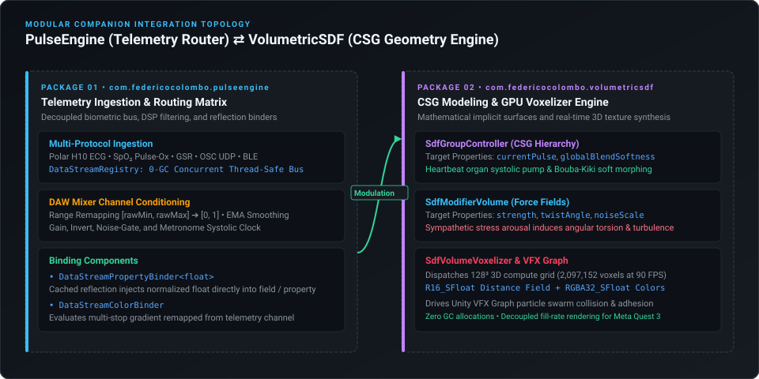
</p>

| PulseEngine Telemetry Channel | Target VolumetricSDF Component | Target Property Name | Clinical & Perceptual Metaphor |
| :--- | :--- | :--- | :--- |
| **`heart_rate`** | `SdfGroupController` | `currentPulse` | Rhythmic organ systolic contraction and diastolic relaxation. |
| **`hrv_rmssd`** | `SdfGroupController` | `globalBlendSoftness` | Vagal nerve parasympathetic tone: high HRV relaxes shapes into Bouba; low HRV sharpens edges. |
| **`spo2`** | `VisualEffect` | `ParticleColor` (Gradient) | Blood oxygenation: arterial crimson ($98\%$) to cyanotic indigo ($85\%$). |
| **`stress_index`** | `SdfModifierVolume` | `strength` | Autonomic arousal drives torsional twisting and surface noise. |

---

## 📖 Documentation Directory

The full technical manual is structured according to the official Unity Package documentation standard:

* **[Table of Contents](Documentation~/toc.yml)**
* **[Package Overview](Documentation~/index.md)**
* **[Getting Started Guide](Documentation~/getting-started.md)**
* **[Installation & Setup](Documentation~/installation-and-setup.md)**
* **Procedural Modeling & CSG**:
  * [Primitives & CSG Operations](Documentation~/manual/primitives-and-csg.md)
  * [Bounded Modifier Volumes](Documentation~/manual/modifier-volumes.md)
  * [Triplanar Texturing & MatCaps](Documentation~/manual/surface-texturing.md)
  * [Bouba-Kiki Morphological Continuum](Documentation~/manual/bouba-kiki-continuum.md)
* **GPU Voxelizer & VFX Graph**:
  * [GPU Voxelizer Pipeline](Documentation~/manual/gpu-voxelizer-vfx.md)
  * [Decoupled Chromatic Evaluation](Documentation~/manual/decoupled-colors.md)
* **Performance & Mobile XR**:
  * [Meta Quest 3 Profiling & Fill-Rate Decoupling](Documentation~/manual/quest3-profiling.md)
* **Companion Integrations**:
  * [Driving VolumetricSDF with PulseEngine](Documentation~/manual/pulseengine-integration.md)

---

## 🎓 Academic Research & Citation

VolumetricSDF was developed by **Federico Colombo** as part of the Master's Thesis in *Cinema and Media Engineering* at **Politecnico di Torino** (DAUIN - Dipartimento di Automatica e Informatica), supervised by **Prof. Francesco Strada**.

If you utilize VolumetricSDF in academic research, clinical medical XR trials, or technical art publications, please cite:

```bibtex
@mastersthesis{colombo2026volumetricsdf,
  author       = {Federico Colombo},
  title        = {VolumetricSDF: Real-Time Signed Distance Fields and GPU Voxelization for Technical Art in Medical Extended Reality},
  school       = {Politecnico di Torino},
  year         = {2026},
  month        = {December},
  note         = {Supervisor: Prof. Francesco Strada. DAUIN}
}
```

---

## 📄 License

Distributed under the **MIT License**. See [LICENSE.md](LICENSE.md) for details.
