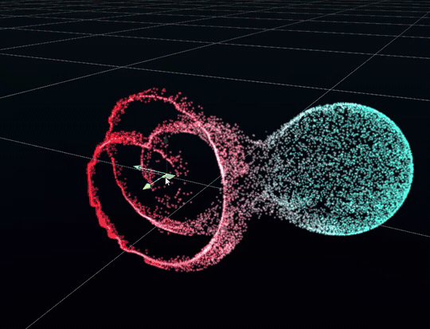
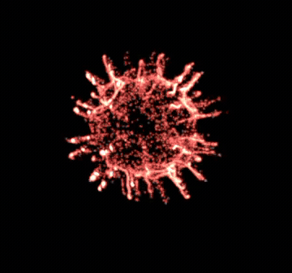
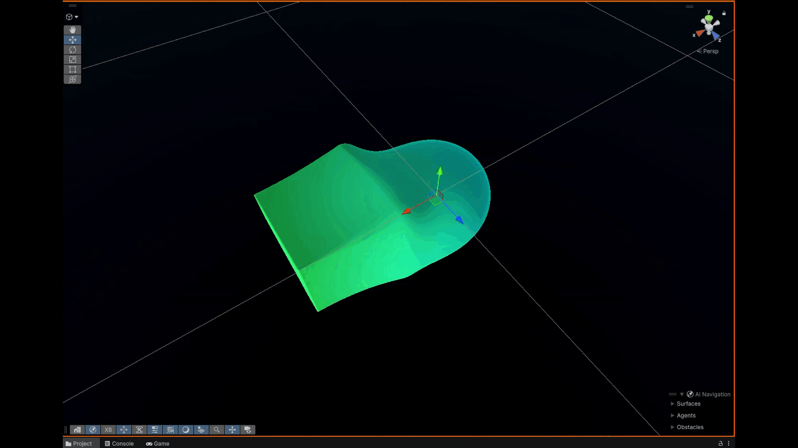
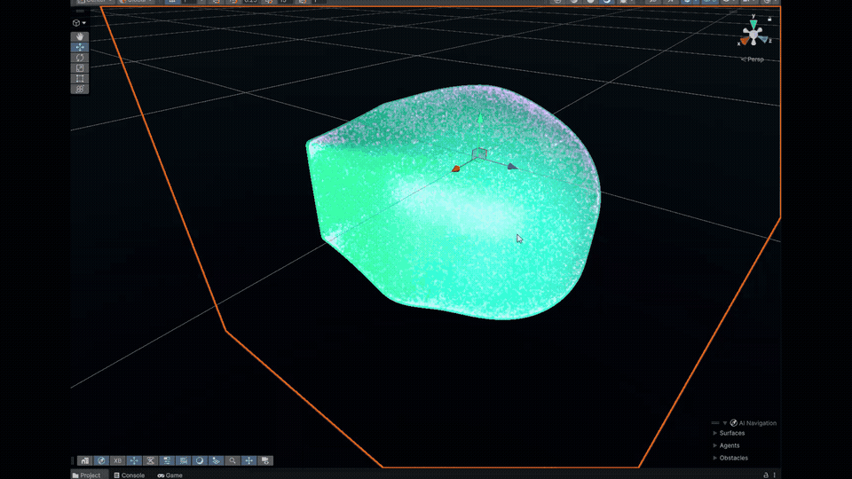

# VolumetricSDF: Real-Time Procedural CSG & GPU Voxelizer Engine

[](https://unity.com/)
[](https://github.com/federicocolombo12/VolumetricSDF)
[](https://www.meta.com/quest/quest-3/)
[](LICENSE)

**VolumetricSDF** is a high-performance procedural implicit modeling and physics suite for Unity (URP / Unity 6). It combines order-independent **Constructive Solid Geometry (CSG)** sphere tracing raymarching, bounded **Modifier Volumes**, Morten Mikkelsen triplanar texturing, and a real-time **GPU Compute Voxelizer** ($16^3$ to $192^3$) with **Decoupled Chromatic Evaluation** for particle swarm interaction in **Unity VFX Graph**.

Originally developed as part of a Master's Thesis in Cinema and Media Engineering at Politecnico di Torino, the engine is optimized for **Mobile XR (Meta Quest 3 Standalone)** through an innovative **Fill-Rate Decoupling** architecture.

---

## 🎬 Showcase

| Decoupled Chromatic Evaluation (VFX Graph) | Bouba-Kiki Morphological Continuum |
| :---: | :---: |
|  |  |
| *World-space decoupled color evaluation on $128^3$ voxel grid.* | *Continuous transition between calm (Bouba) and acute stress (Kiki).* |

| Procedural CSG Modeling & Hierarchy | VFX Particle Adhesion & Collision |
| :---: | :---: |
|  |  |
| *Real-time smooth union, subtraction, and modifier volumes.* | *Particles conforming tightly to implicit SDF distance zero-isosurface.* |

---

## ⚡ Key Architectural Features

### 1. Fill-Rate Decoupling Architecture
Standard sphere tracing raymarching computes distance evaluations per fragment ($O(\text{Width} \times \text{Height})$). At Meta Quest 3 native stereo render targets ($2064 \times 2208$ per eye), fullscreen raymarching incurs severe GPU fill-rate throttling (~42 ms per frame).

**VolumetricSDF** introduces **Fill-Rate Decoupling**:
- The procedural distance field is evaluated offscreen on the compute pipeline (`SdfVolumeVoxelizer.compute`) into a 3D `RenderTexture` (format `RGBAHalf`).
- Collision physics, particle adhesion (`Conform to SDF`), and visual rendering are delegated to **Unity VFX Graph** sampling the 3D texture.
- The visual raymarch mesh can be disabled entirely while retaining 100% collision accuracy, dropping GPU frame time from **42.4 ms to 11.2 ms (locked 72 FPS on Quest 3)**.

### 2. Decoupled Chromatic Evaluation
Unlike classic SDF systems that only bake a scalar scalar distance $d$, `SdfVolumeVoxelizer` evaluates both distance and localized shape color in a single compute pass:
- **RGB Channels**: World-space interpolated color fields derived from analytical node colors, modifier volumes, and organic tissue gradients.
- **Alpha Channel**: Signed Distance value $d(x, y, z)$.
- Allows VFX Graph particles to dynamically inherit the physiological state or organic tissue color of the underlying SDF geometry.

### 3. Order-Independent CSG Cascade
Hierarchical CSG blending evaluated top-to-bottom according to Unity Sibling Index:
- **Primitives**: Sphere, Box, Torus, Cylinder, Capsule, and Baked 3D Textures (`.asset`).
- **Operations**:
  - `Union` / `SmoothUnion`
  - `Subtraction` / `SmoothSubtraction`
  - `Intersection` / `SmoothIntersection`
- **Polynomial Smooth Blending**:
  $$\text{smin}(a, b, k) = \min(a, b) - \frac{h^2 k}{4}, \quad h = \max\left(k - |a - b|, 0\right)$$

### 4. Bounded Modifier Volumes (Force-Fields)
Localized volumetric influence zones modifying the implicit distance field without altering global coordinates:
- **Twist**: Continuous angular torsion along local axis.
- **Bend**: Polynomial deformation curve.
- **Noise**: 3D Perlin/Simplex displacement with frequency and strength controls.
- **Falloff**: Smooth cubic hermite attenuation ($3x^2 - 2x^3$) between inner core and outer bounding box.

### 5. Bouba-Kiki Morphological Continuum
Algorithmic implementation of the Köhler cross-modal correspondence effect:
- **Bouba Archetype**: Low harmonic frequencies, high $k$-softness, spherical curvature ($H > 0$), representing parasympathetic relaxation.
- **Kiki Archetype**: High frequency noise, sharp directional tapering, angular spikes ($K < 0$), representing sympathetic arousal / acute stress.
- Includes custom editor baker (`BoubaKikiTexture3DGenerator`) to generate $32^3$ to $128^3$ volumetric assets from procedural equations or 3D meshes.

---

## 📊 Meta Quest 3 Standalone Benchmarks

Measurements recorded on Meta Quest 3 Standalone (Snapdragon XR2 Gen 2, Vulkan, URP FFR Level 2):

| Mode / Resolution | Frame Time (ms) | FPS | GPU VRAM (MB) | Total Voxels | Fill-Rate Decoupled |
| :--- | :---: | :---: | :---: | :---: | :---: |
| **Fullscreen Raymarch Only** | $42.4 \text{ ms}$ | $23.5$ | $0.0 \text{ MB}$ | N/A (per-pixel) | ❌ No |
| **Voxelizer $32^3$** | $10.1 \text{ ms}$ | **72 FPS** | $0.25 \text{ MB}$ | $32,768$ | ✅ Yes |
| **Voxelizer $64^3$ (Recommended)** | $10.8 \text{ ms}$ | **72 FPS** | $2.00 \text{ MB}$ | $262,144$ | ✅ Yes |
| **Voxelizer $96^3$** | $11.6 \text{ ms}$ | **72 FPS** | $6.75 \text{ MB}$ | $884,736$ | ✅ Yes |
| **Voxelizer $128^3$** | $13.8 \text{ ms}$ | **72 FPS** | $16.00 \text{ MB}$ | $2,097,152$ | ✅ Yes |

> [!NOTE]
> Testing confirms that **$64^3$ to $96^3$** delivers an optimal balance between volumetric detail and particle collision fidelity on mobile headsets with less than $7\text{ MB}$ VRAM overhead.

---

## 📦 Installation via Unity Package Manager (UPM)

In Unity (2022.3 LTS, 2023 LTS, or Unity 6):

1. Open **Window** > **Package Manager**.
2. Click **+** (top-left) > **Add package from git URL...**
3. Enter the Git URL:
   ```text
   https://github.com/federicocolombo12/VolumetricSDF.git
   ```

### Dependencies
- `com.unity.render-pipelines.universal` (URP)
- `com.unity.visualeffectgraph`
- `com.unity.mathematics`

---

## 🚀 Quick Start Guide

### 1. Create an SDF Volume
1. In your scene hierarchy, create an empty GameObject named `SDF_Volume`.
2. Add the component **`SdfGroupController`**.
3. Add a child GameObject named `SdfNode_Sphere`, and attach **`SdfNode`**.
4. Duplicate the child, change `Shape Type` to `Torus` or `Box`, set `Combine Op` to `SmoothUnion`, and adjust `Blend Softness`.

### 2. Enable Real-Time GPU Voxelization
1. On the `SDF_Volume` GameObject, add **`SdfVolumeVoxelizer`**.
2. Set `Texture Resolution` to `64` or `96`.
3. In your target **Visual Effect (VFX Graph)**:
   - Create blackboard parameters:
     - `SdfVolumeTexture` (Texture3D)
     - `SdfVolumeSize` (Vector3)
     - `SdfVolumeCenter` (Vector3)
     - `SdfVolumeTransform` (Matrix4x4)
   - Add the **Conform to SDF** block in the Update Context or **Sample SDF Texture** in the Output Context.
4. Drag your VFX component into `Target VFX Graph` on `SdfVolumeVoxelizer`. The parameters will link automatically!

---

## 🤝 Companion Package: PulseEngine

For real-time telemetry routing, biofeedback sensors (ECG, SpO2, HRV via OSC/UDP/WebSockets), and virtual DAW mixing, pair this package with:
👉 **[PulseEngine](https://github.com/federicocolombo12/PulseEngine)** (`com.federicocolombo.pulseengine`)

When both packages are installed, `VolumetricSDF` automatically enables deep telemetry binding rules without any configuration required.

---

## 📄 License
This project is licensed under the MIT License - see the [LICENSE](LICENSE) file for details.

Developed by **Federico Colombo**  
Politecnico di Torino — Master's Degree in Cinema and Media Engineering  
Contact: chiccoclub5@gmail.com
